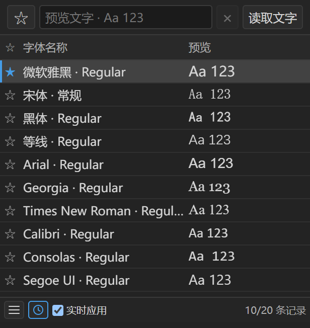

# 字体预览器 · Font Browser

[下载字体预览器.zip](./%E5%AD%97%E4%BD%93%E9%A2%84%E8%A7%88%E5%99%A8.zip?raw=true)

这是 Windows 版 After Effects 的 CEP 面板。扩展清单允许 AE 22.x 至 26.x 加载，要求 CEP 11 或 12。跨版本实际加载尚未逐一验证。先解压完整 ZIP，再手动安装到系统 CEP 目录。

## 手动安装或更新

1. 保存工程并关闭 After Effects。
2. 在交付目录中复制整个 **`cn.local.aefontbrowser`** 文件夹。它里面直接包含 `CSXS`、`index.html` 和 `host.jsx` 等面板文件。
3. 在文件资源管理器的地址栏输入 `C:\Program Files (x86)\Common Files\Adobe\CEP\extensions`，把刚才复制的文件夹粘贴进去。更新时将同名文件夹合并，选择替换同名文件。如果 Windows 提示需要管理员权限，点击“继续”。粘贴后，清单文件应位于 `C:\Program Files (x86)\Common Files\Adobe\CEP\extensions\cn.local.aefontbrowser\CSXS\manifest.xml`。
4. 首次使用时，按下方步骤运行 `Enable-Cep.ps1`。已为相应版本启用 CEP 调试模式时，可跳过。
5. 打开 After Effects，从 **窗口 → 扩展 → 字体预览器 · Font Browser** 打开面板。

## 使用

- **预览**。字体家族默认折叠。名称前有小圆点表示有多个样式，点名称展开或收起。顶部可输入预览文字，或选中文字图层后点“读取文字”。字体会按当前文字排序，能显示全部字符的家族排在上方，缺字的排在后面。点 × 可清空并恢复原顺序，留空时用 `Aa 123` 预览。
- **收藏**。点行首星标收藏或取消收藏整个字体家族。点顶部星标切换“只看收藏”，再点一次恢复全部字体。此前收藏过的字重会合并为家族收藏。
- **换字体**。在时间轴选中文字图层，双击字体或展开后双击某个样式。键盘在家族行按 Enter 展开或收起，在样式行按 Enter 应用。开启“实时应用”后，单击具体样式即可换字体，开关状态会在下次打开时恢复。每次应用可用 Ctrl+Z 撤销。
- **显示设置**。点底部三横线图标调整预览字号、滚轮步幅或刷新字体。方向键和 Page Up / Page Down 可浏览列表。
- **最近使用**。点底部时钟图标查看最近成功应用的 20 个不同字体样式。在历史列表里试用字体时，记录顺序保持固定。从全部字体或收藏列表应用字体时，才会更新历史。
- **定位图层字体**。结束文字编辑后，在时间轴选中文字图层，点击“读取文字”。面板会读取图层内容，并高亮和定位到列表中的对应字体。若同时选中多个图层，面板读取第一个未锁定的文字图层。
- **源文本限制**。应用前会跳过锁定、源文本已有关键帧或启用了表达式的图层。换字体时作用于整个文字图层，原先混用的字体会统一为所选字体。

面板扫描 Windows 系统和当前用户的 OpenType/TrueType 字体（TTF、OTF、TTC、OTC）。只在 Adobe 内激活的云字体可能不在列表中。字体缺少某个字符时，预览可能使用系统回退字形，最终效果以 AE 合成画面为准。

## 卸载

关闭 AE，在文件资源管理器中打开 `C:\Program Files (x86)\Common Files\Adobe\CEP\extensions`，只删除 `cn.local.aefontbrowser` 文件夹，然后重新打开 AE。收藏和面板设置保存在当前用户的 CEP 数据中。